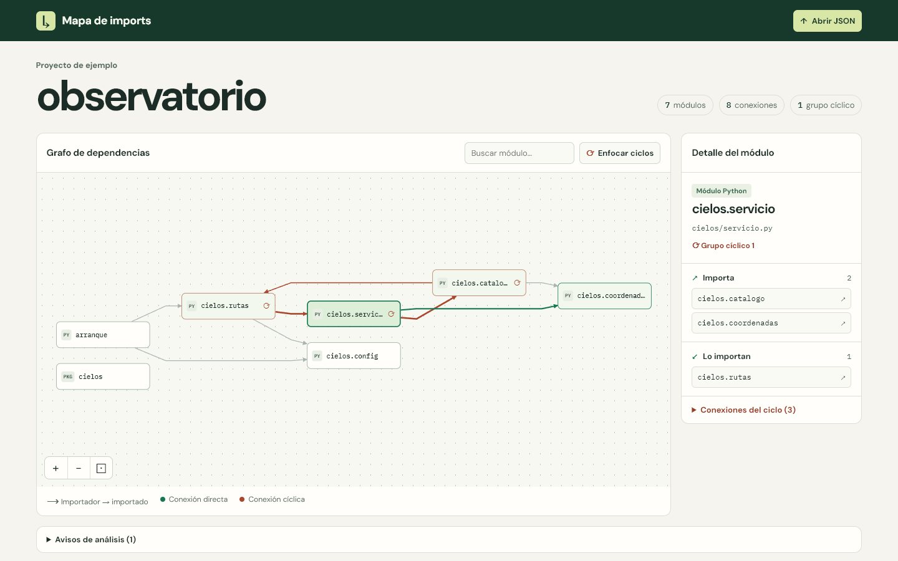

# Mapa de imports

Explora las dependencias estáticas entre módulos Python. Cada flecha sale del módulo que importa y apunta al módulo importado. Selecciona un nodo para ver sus conexiones directas, busca un módulo por nombre o enfoca un grupo cíclico para inspeccionar sus flechas.

[Abre la demo en GitHub Pages](https://humiumii.github.io/visor-dependencias-python/)



## Analiza tu propio proyecto

Necesitas Python 3.10 o superior. Desde el repositorio, ejecuta:

```sh
python analizar.py ruta/al/proyecto -o dependencias.json
```

Entrega la raíz de importación del código. Si tu proyecto usa una estructura con `src/`, normalmente analizarás esa carpeta. Si pasas directamente una carpeta importable que contiene `__init__.py`, el analizador la trata como paquete y usa el nombre de la carpeta como prefijo. Si omites `-o`, la CLI escribe el JSON en la salida estándar.

En la demo, selecciona **Abrir JSON** y elige el informe. El navegador lo lee desde tu equipo. El informe incluye nombres, rutas relativas, conexiones y avisos con número de línea cuando está disponible. El sitio funciona con archivos estáticos y procesa los informes dentro de la pestaña.

## Cómo funciona

- **Imports.** El analizador lee archivos `.py` como texto, respeta la codificación declarada y usa `ast` para encontrar `import` y `from … import …`. Usa las rutas para construir nombres de módulos, incluyendo paquetes con `__init__.py`, y resuelve los puntos iniciales de los imports relativos a partir del paquete que contiene el archivo. En `from paquete import nombre`, conecta al submódulo cuando hay una coincidencia única y sin señales estáticas de conflicto. Si el nombre solo identifica un miembro de un módulo explícito, registra la dependencia al módulo base. Los imports externos, las ambigüedades y los errores de lectura o sintaxis aparecen como avisos. Los demás archivos se siguen analizando.
- **Ciclos.** El visor aplica el algoritmo de Kosaraju al grafo dirigido. Cada componente fuertemente conexa de dos o más módulos se muestra como un grupo cíclico. Un módulo con una flecha hacia sí mismo forma un grupo propio. El panel lista las conexiones internas del grupo, incluidos los casos con varios recorridos posibles.
- **Alcance.** El análisis no importa ni ejecuta el código. Quedan fuera los imports dinámicos, los cambios de `sys.path`, los importadores personalizados, las extensiones compiladas, la ejecución implícita de inicializadores por cada prefijo y la resolución completa de atributos de paquetes en tiempo de ejecución. Los imports bajo condiciones, funciones, `try` o `TYPE_CHECKING` cuentan como dependencias estáticas. Un ciclo muestra una relación estructural y puede involucrar imports que se ejecutan en momentos distintos.

El ejemplo ficticio de `examples/observatorio/` incluye un ciclo indirecto, imports relativos, módulos fuera de ciclos y un import externo a la raíz. Para regenerar su informe:

```sh
python analizar.py examples/observatorio -o web/observatorio.json
```

## Desarrollo

Requiere Node.js 24 para el visor y sus pruebas.

```sh
python -m unittest -v
npm ci
npm test
npm run build
npm run preview
```

GitHub Actions ejecuta las pruebas y el build. Cuando la rama `main` pasa la verificación, publica `dist/` en GitHub Pages.
